<h1 align="center">Minecraft PE 0.6.1 Windows Universal</h1>

<a href="README_zh-CN.md">简体中文</a>

This project is a Windows-focused continuation of the leaked Minecraft Pocket Edition 0.6.1 source code. It modernizes and maintains the game for Windows x86, x64 and ARM64, while adding input, rendering, world-generation and user-interface improvements.

If you are interested in the UWP build, please visit [Minecraft PE 0.6.1 UWP](https://github.com/CanghaiDragon/Minecraft-PE-0.6.1-UWP).

This project is intended for educational and preservation purposes only. Feel free to fork this project, but **DO NOT** use it for commercial purposes.

---

<h2 align="center">Gallery</h2>

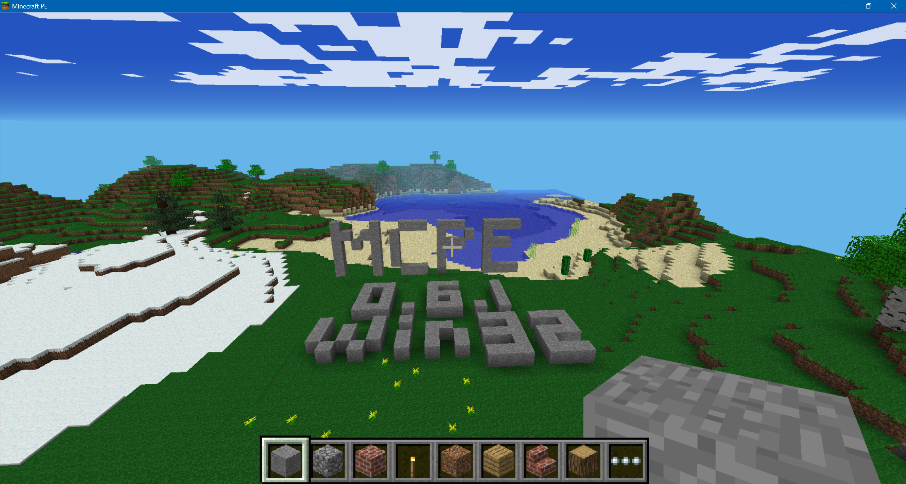

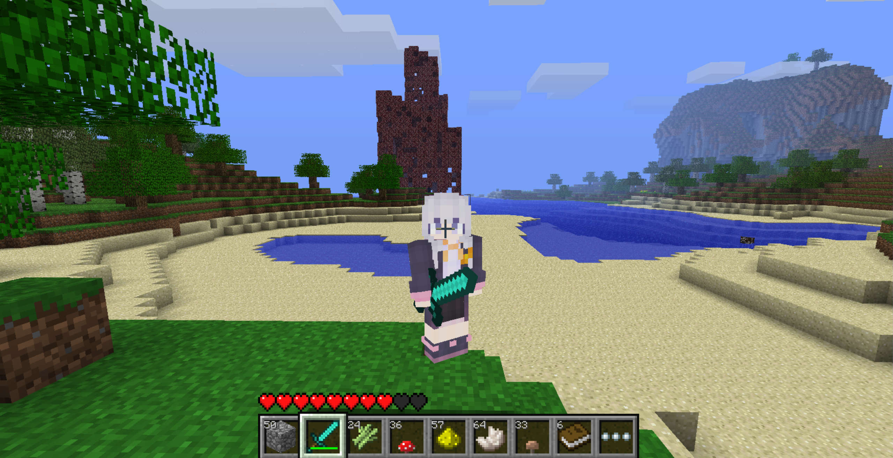

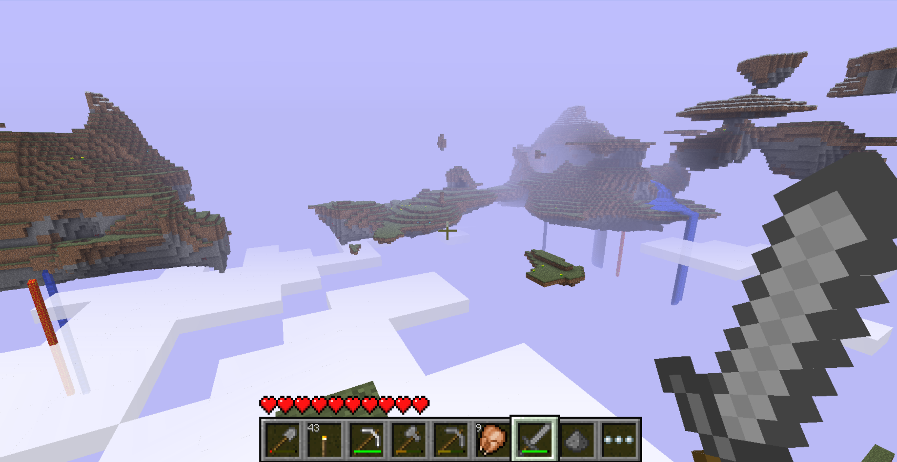

---

<h2 align="center">Project status</h2>

| Target        | Status                              | Build system  |
| ------------- | ----------------------------------- | ------------- |
| Windows x86   | Supported                           | Visual Studio |
| Windows x64   | Supported                           | Visual Studio |
| Windows ARM64 | Supported                           | Visual Studio |
| Windows ARM32 | Experimental; No longer maintaining | Visual Studio |

The project is primarily developed and tested on Windows. Other platforms from the upstream projects are not official targets of this repository.

---

<h2 align="center">Upstream projects and references</h2>

In March 2026, the source code of Minecraft Pocket Edition v0.6.1 was leaked on the Internet. You can find it at [Minecraft PE Source Code](https://archive.org/details/Minecraftpesorucecode). This is the reason why several revisions of MCPE0.6.1 appears on github and other sites. This project is also a revision of the origin code. All the revisions **DO NOT** have direct authorization from Mojang.

This project originated from [programmer1o1/MinecraftPE-v0.6.1](https://github.com/programmer1o1/MinecraftPE-v0.6.1), referred to below as **Project B**. Project B provides the main modernized source base and multi-platform porting work.

Some Java Beta visual ideas and related implementation details were studied from [minecraft-pe-0.6.1-on-all](https://github.com/Minecraft-PE-0-6-1/minecraft-pe-0.6.1-on-all), referred to below as **Project A**.

The Sky world and several visual behaviors were implemented with reference to Minecraft Java Edition Beta 1.7.3 source code using Mod Coder Pack 4.3. Alpha world is referenced to Java Edition Alpha 1.1.2_01 using Mode Coder Pack 1.6. These references do not imply official affiliation or authorization by Mojang.

The main work of this project is assisted with the help of Codex.

---

<h2 align="center">Features</h2>

### Original MCPE features

- Old finite-world generation
- Mobs, lighting, sky rendering and the Nether Reactor
- Touchscreen controls

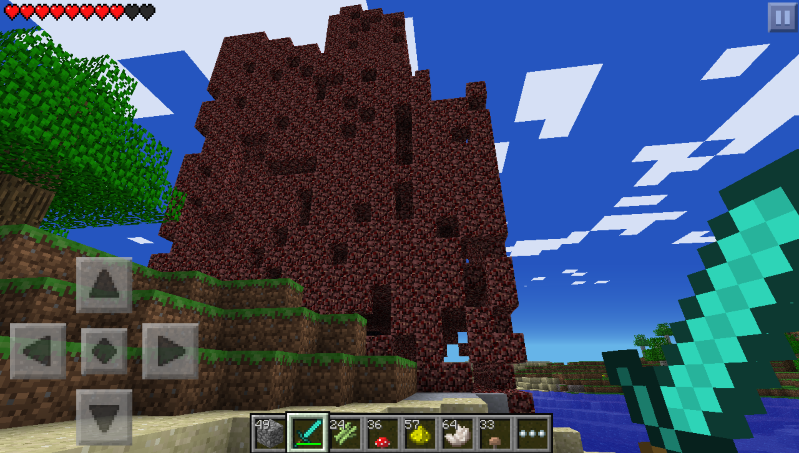

The terminated Nether Reactor Towel

### Additional gaming features

The additional features below can be experienced after opening the corresponding settings in Options → Additional. If you wish to have an experience close to the original MCPE 0.6.1, you can leave those settings off.

- More world type (Infinite, Sky and Alpha)

- Java Edition Beta visual effects

- Skin settings and skin import support

- Touch sneak option

- F3 Debug Screen

- Java Edition style UI

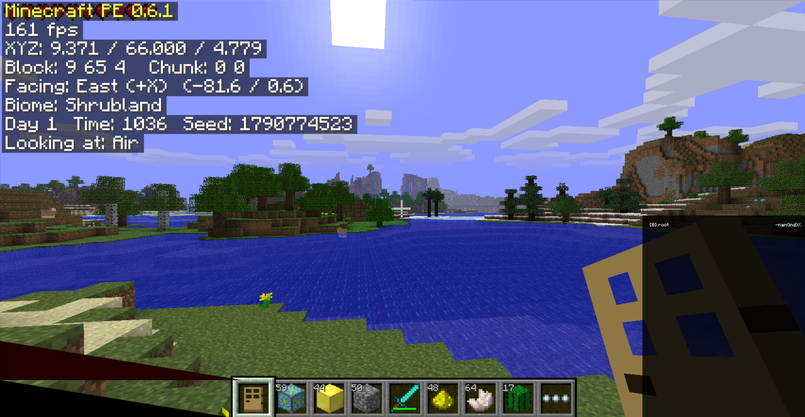

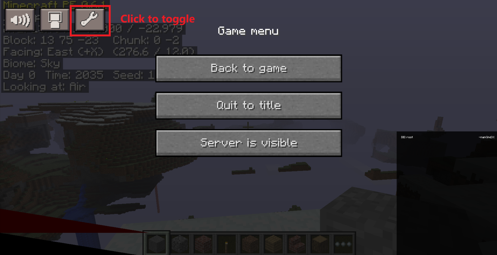

F3 Debug Screen

### Improvements

- Keyboard and mouse controls, including mouse capture and crosshair-centered mouse look
- Selectable touch or keyboard/mouse input mode
- Creative-mode running and "Spectator mode"
- Improved block interaction and touchscreen controls
- Render-distance and smooth-lighting options

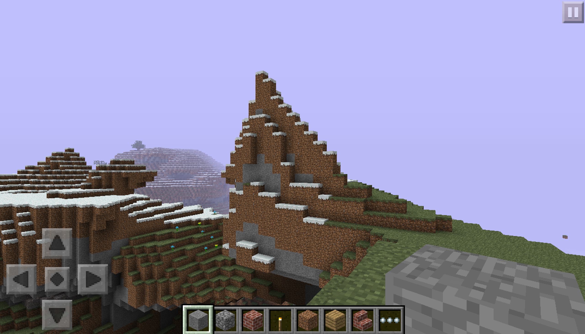

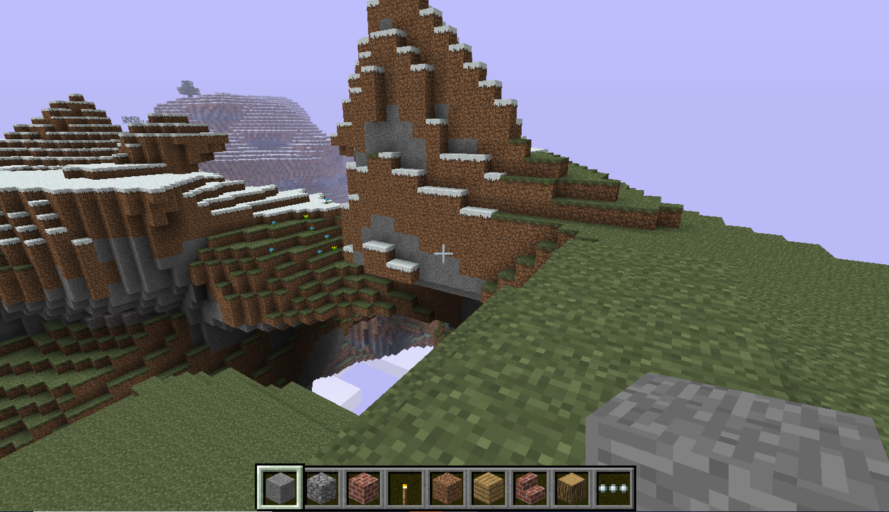

Different gaming screenshots under different input mode

### Interface and customization

- Welcome screen for choosing input mode, performance setting and GUI scale
- Adjustable GUI and D-pad sizes

---

<h2 align="center">World types</h2>

**IMPORTANT**: Infinite, Sky and Alpha world have a level saving format different from both the original MCPE 0.6.1 and later MCPE infinite versions like 0.9. Therefore, these three world types **CANNOT** be converted and opened in any versions of original MCPE at the moment. Future plans include Infinite/Sky world conversion tools for later MCPE versions. Meanwhile, classic finite worlds retain the original MCPE 0.6.1 save format. saves from 0.1-0.8 original PE are supported.

### Old (finite) world

The original world type uses the same generator as the original MCPE 0.6.1. Players can play in a world with a boundary of 256×256, and the outer space is filled with invisible bedrock. Cave is unabled in the origin 0.6.1, and this version inherits this feature. Note that due to random-number variation, the spawn point in Creative mode and Survival mode is different in the original MCPE 0.6.1. This project inherits this feature.

### Infinite world

Infinite worlds use multi-region chunk storage and support exploration beyond the original 256×256 world boundary. The generator is adapted from the finite generator, which means you can find the exact same terrain as the finite world at coordinates within the finite-world boundary when using the same seed. The feature of different spawn points in Survival and Creative modes is also inherited. Cave is enabled.

### Sky world

Sky world is a floating-island world type based on the unused Sky dimension logic in Java Edition Beta 1.6 - 1.8. It uses a fixed Sky biome and separate terrain generation rules. Clouds are below the floating island. The sky color is light purple (only when Java Beta Visual is enabled). Cave is enabled. Several changes have been made to ensure playability in Survival mode:

* 4 types of animals can all spawn instead of only chickens. Chickens still have a higher spawn rate than the other three types of animals.

* Day-night cycle is kept in survival mode.

* The lowest block of the floating island is around Y = 18, so in Java Edition, diamonds cannot spawn in Sky. Here, ores generate in the height range where blocks generate, so diamonds can be found. Rate of gold ores is also increased, easier for making nether reactor.

* To balance the difficulty, mobs only spawn when the light level is low enough and there is at least one block above along the Y axis, which means mobs do not spawn at night in open areas.

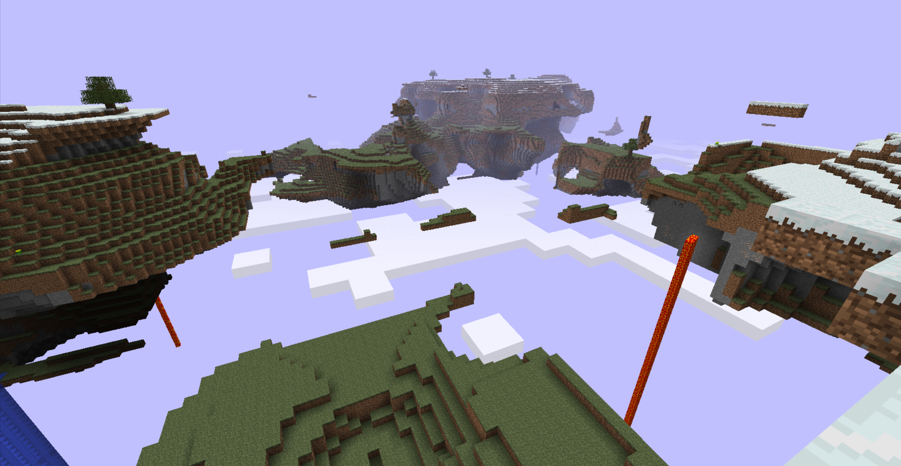

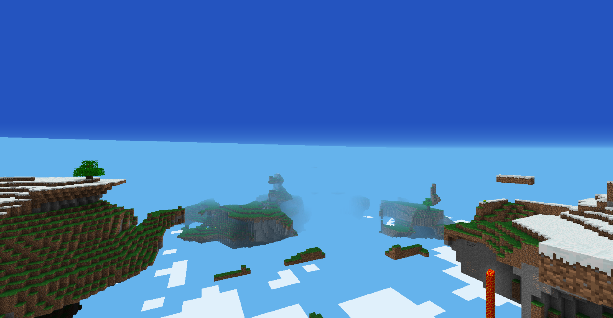

Difference view of Sky world under Java Beta and PE visual

### Alpha World

The world type based on Java Edition Alpha v1.1.2_01. Only the biome "Alpha" or "Winter" will generate to stimulate the situation of Java Edition early stage. Trees and grass blocks are in light green colors, separate from later Minecraft versions. Cave is enabled. There is a chance of 25% to enter the "Winter" world when creating a Alpha world.

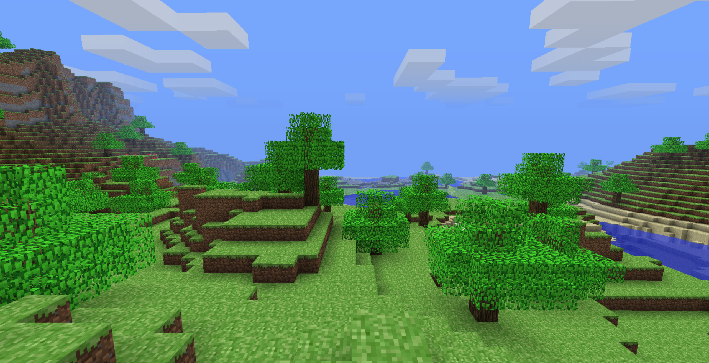

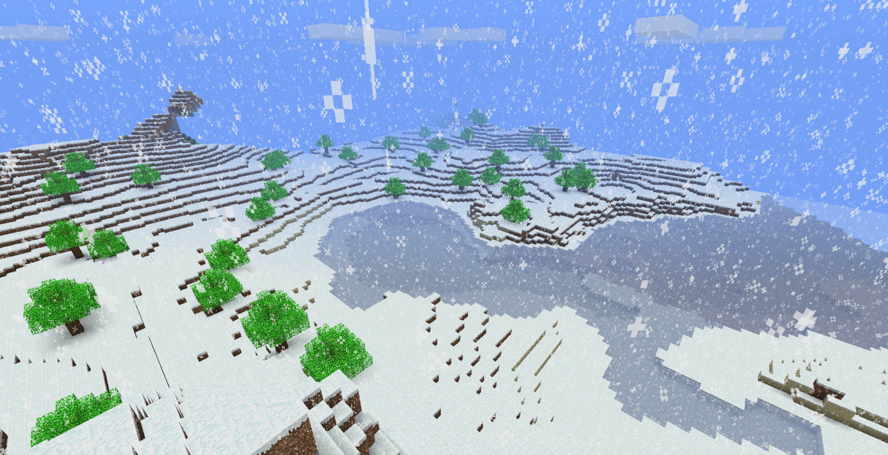

Normal Alpha world and the special "Winter" Alpha world

---

<h2 align="center">Core technical implementation</h2>

- Native WGL-based desktop OpenGL rendering, replacing the earlier PowerVR OpenGL ES emulation path.
- Windows x86, x64 and ARM64 builds, with an experimental ARM32 configuration.
- Keyboard, mouse and touchscreen input handling, including block targeting and interaction improvements.
- Multi-region chunk storage and extended-world generation for Infinite, Sky and Alpha worlds.
- Chunk-boundary rendering, lighting and spawn-handling improvements for extended worlds.
- Original finite-world save format retained for compatibility with classic MCPE worlds.

For historical fixes and version-specific changes, see the [Update log](Update_log.md).

---

<h2 align="center">Building</h2>

Open the corresponding Visual Studio solution:

| Target        | Solution                                       |
| ------------- | ---------------------------------------------- |
| Windows x86   | `handheld/project/x86/MinecraftWin32.sln`      |
| Windows x64   | `handheld/project/x64/MinecraftWin64.sln`      |
| Windows ARM64 | `handheld/project/arm64/MinecraftWinARM64.sln` |
| Windows ARM32 | `handheld/project/arm/MinecraftWinARM.sln`     |

Select the desired architecture and configuration in Visual Studio. Release builds are recommended for normal performance testing. Debug builds are intended for debugging and may run substantially slower.

The required native libraries and runtime files are available in the project’s platform-specific library and game directories. The exact dependency layout is kept with the Visual Studio projects. After compiling the game, you need to copy `MCPE0.6.1Universal\handheld\data` and 4 dependencies in different architecture folders inside `MCPE0.6.1Universal\handheld\lib\bin` to run the game.

Currently, the ARM32 build is able to launch and run on my Windows on ARM device. As WOA do not support VBO for WGL on ARM32, the ARM32 game can only render with OpenGL 1.1, and even with the lowest graphics settings, it only achieves around 10 FPS. Due to these severe performance and rendering issues, ARM32 binaries will not be included in GitHub Releases, although the source code and build configuration will remain available.

As UWP version with ARM32 support is implemented, this unfinished ARM32 win32 build may not be furtherly developed. If your Windows RT device is in Windows 10 desktop ARM32, you can try [my UWP version](https://github.com/CanghaiDragon/Minecraft-PE-0.6.1-UWP). If your RT device is still in Windows 8, you may try [MCPE-0.6.1-WindowsRT](https://github.com/SamuraiArtem/MCPE-0.6.1-WindowsRT) (I am not the author of this WindowsRT repository).

---

<h2 align="center">Keyboard Controls</h2>

| Key / Action | Function                    |
| ------------ | --------------------------- |
| W A S D      | Move                        |
| Space        | Jump                        |
| Left Shift   | Sneak                       |
| Left click   | Mine / Attack               |
| Right click  | Place block / Interact      |
| 1 - 9        | Select hotbar slot          |
| Scroll wheel | Scroll hotbar               |
| E            | Open inventory              |
| Ctrl         | Toggle run (Creative)       |
| F            | Toggle Spectator (Creative) |
| Q            | Drop item                   |
| R            | Crafting (Survival)         |
| F1           | Toggle hide HUD             |
| F3           | Toggle Debug Screen         |
| F5           | Toggle third-person view    |
| Escape       | Pause / back                |

---

<h2 align="center">Known limitations</h2>

- Vibrate on Destroy is not implemented on Windows win32.
- Skin changes may require restarting the game.
- ARM32 remains experimental and have performance and rendering compatibility issues.
- Multiplayer for Infinite and Sky worlds is not currently supported.

---

<h2 align="center">Future plans</h2>

* Chinese localization

* Infinite/Sky world conversion tools for later MCPE versions (Already in Progress!)

* Possible achievement system

* Multiplayer for Infinite/Sky world

---

<h2 align="center">Attribution</h2>

This repository is an independent continuation based on leaked Minecraft Pocket Edition 0.6.1 source code and related community projects. Please retain the upstream references when redistributing source code or derivative work.

The project is not affiliated with or endorsed by Mojang Studios or Microsoft.
