<h1 align="center">Minecraft PE 0.6.1 Windows Universal</h1>

<a href="README.md">English</a>

本项目是基于泄露的 Minecraft Pocket Edition 0.6.1 源代码开发的、以 Windows 为主要目标平台的延续项目。项目对游戏进行了现代化维护，使其支持 Windows x86、x64 和 ARM64，同时加入了输入、渲染、世界生成和用户界面等方面的改进。

如果你对 UWP 版本感兴趣，请访问 [Minecraft PE 0.6.1 UWP](https://github.com/CanghaiDragon/Minecraft-PE-0.6.1-UWP)。

本项目仅用于教育和软件保存目的。欢迎 Fork 本项目，但**请勿将其用于商业用途**。

---

<h2 align="center">游戏截图</h2>

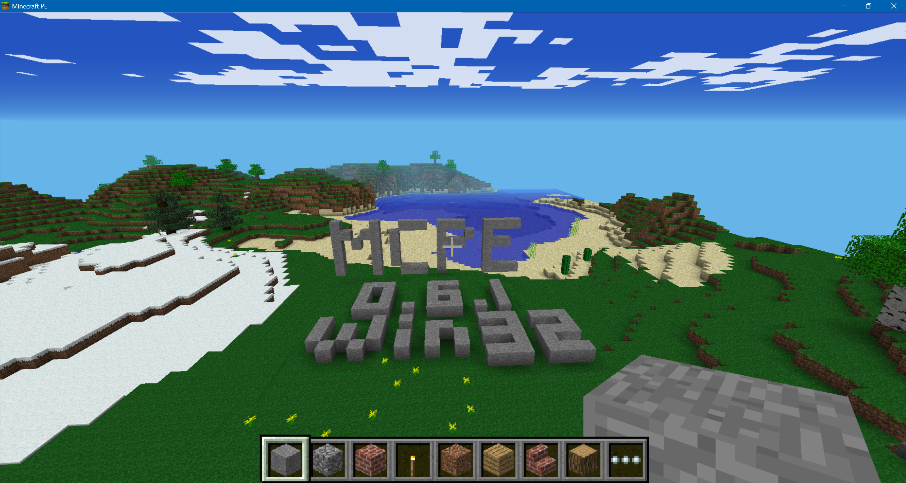

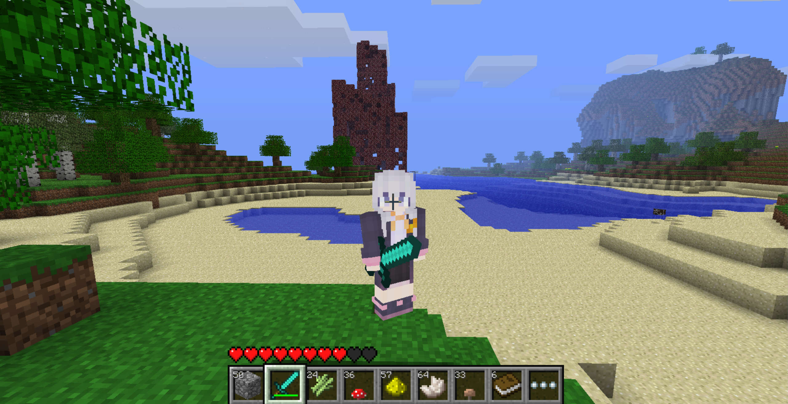

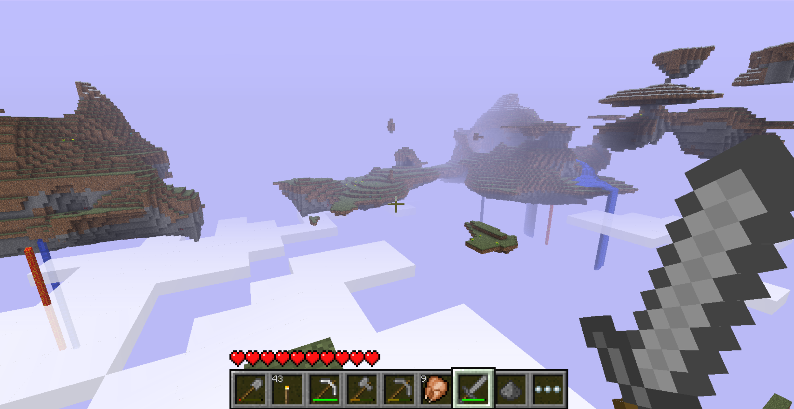

---

<h2 align="center">项目状态</h2>

| 目标平台          | 状态          | 构建系统          |
| ------------- | ----------- | ------------- |
| Windows x86   | 支持          | Visual Studio |
| Windows x64   | 支持          | Visual Studio |
| Windows ARM64 | 支持          | Visual Studio |
| Windows ARM32 | 实验性支持；已停止维护 | Visual Studio |

本项目主要面向 Windows 进行开发和测试。上游项目支持的其他平台并非本仓库的正式目标平台。

---

<h2 align="center">上游项目与参考资料</h2>

2026 年 3 月，Minecraft Pocket Edition v0.6.1 的源代码在互联网上泄露，可在 [Minecraft PE Source Code](https://archive.org/details/Minecraftpesorucecode) 找到。这也是 GitHub 等网站上出现多个 MCPE 0.6.1 修改版本的原因。本项目同样基于原始代码进行修改。所有这些修改版本均**未获得 Mojang 的直接授权**。

本项目源自 [programmer1o1/MinecraftPE-v0.6.1](https://github.com/programmer1o1/MinecraftPE-v0.6.1)，下文称为 **Project B**。Project B 提供了主要的现代化源码基础以及多平台移植工作。

部分 Java Beta 视觉效果的思路和相关实现参考了 [minecraft-pe-0.6.1-on-all](https://github.com/Minecraft-PE-0-6-1/minecraft-pe-0.6.1-on-all)，下文称为 **Project A**。

天域世界及部分视觉效果参考了通过 Mod Coder Pack 4.3 处理的 Minecraft Java Edition Beta 1.7.3 源代码。Alpha 世界参考了通过 Mod Coder Pack 1.6 处理的 Java Edition Alpha 1.1.2_01 源代码。这些参考不代表本项目与 Mojang 存在官方关联或获得其授权。

本项目的主要开发工作在 Codex 的协助下完成。

---

<h2 align="center">功能</h2>

### 原版 MCPE 功能

- 原版有限世界生成
- 生物、光照、天空渲染以及下界反应堆
- 触摸屏操作

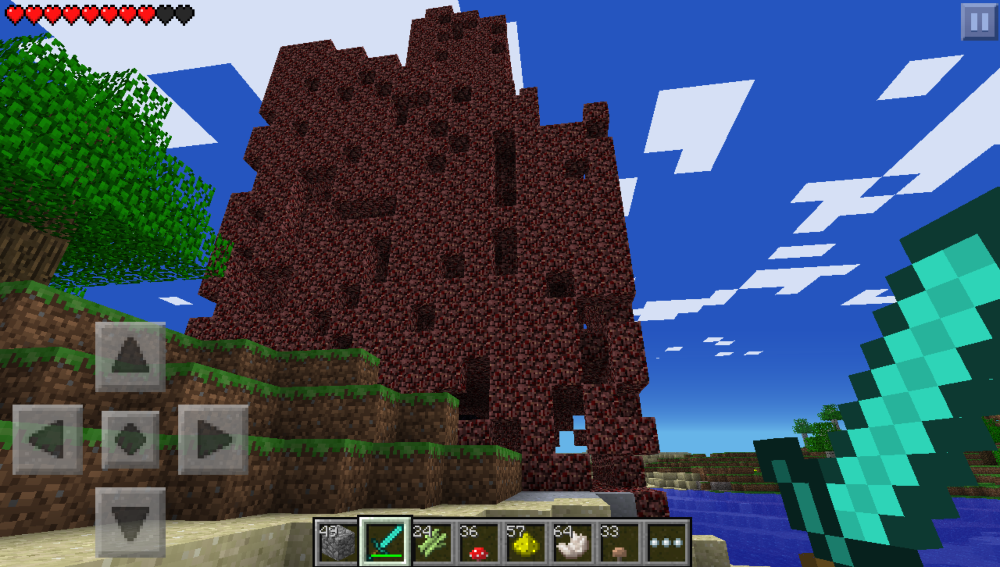

运行结束后的下界反应堆塔

### 新增游戏功能

以下功能可以在 Options（选项）→ Additional（附加设置）中开启。如果希望获得接近原版 MCPE 0.6.1 的游戏体验，可以保持相应选项关闭。

- 更多世界类型（Infinite 无限世界、Sky 天域世界和 Alpha 世界）
- Java Edition Beta 风格视觉效果
- 皮肤设置和皮肤导入支持
- 触摸屏潜行选项
- F3 调试界面
- Java Edition 风格 UI

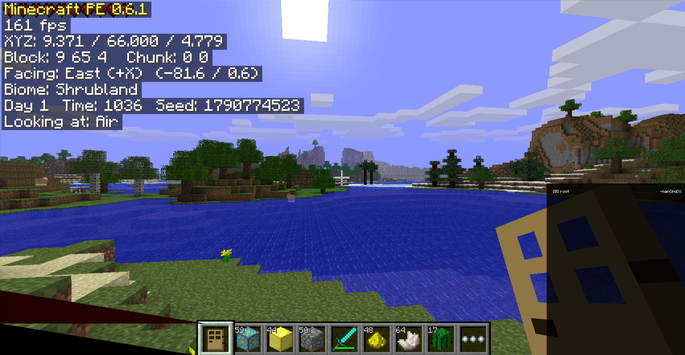

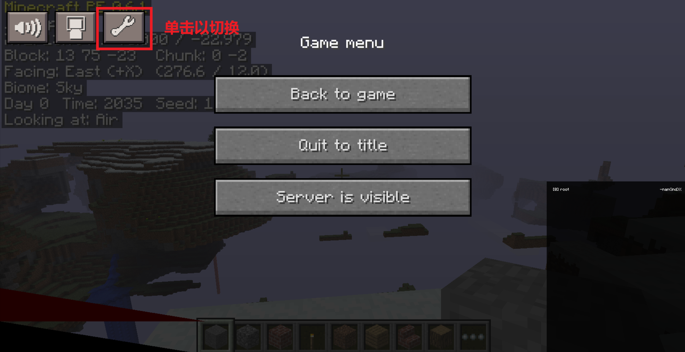

F3 调试界面

### 改进

- 键盘和鼠标操作，包括鼠标捕获及以准星为中心的视角控制
- 可选择触摸或键盘/鼠标输入模式
- 创造模式奔跑和“旁观模式”
- 改进方块交互和触摸屏操作
- 可调整渲染距离和平滑光照

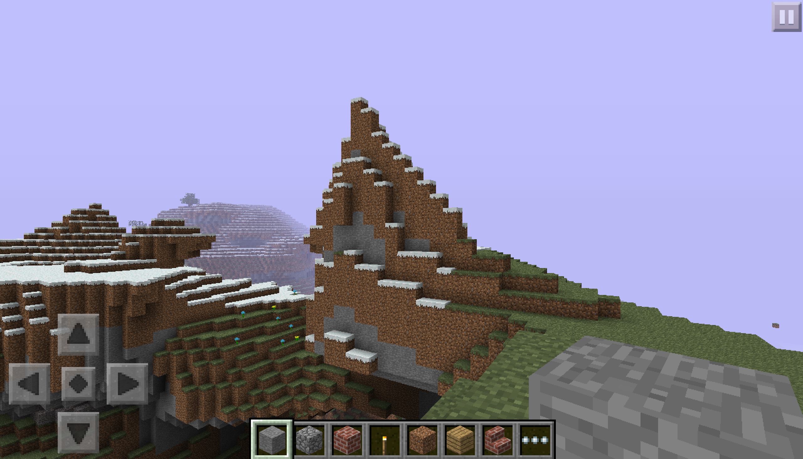

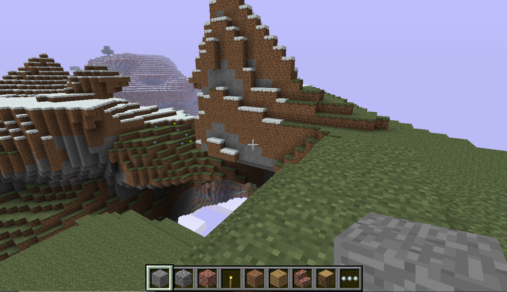

不同输入模式下的游戏画面

### 界面与自定义

- 欢迎界面，可选择输入模式、性能设置和 GUI 缩放
- 可调整 GUI 和虚拟方向键大小

---

<h2 align="center">世界类型</h2>

**重要提醒：** Infinite（无限）、Sky（天域）和 Alpha 世界采用的存档格式既不同于原版 MCPE 0.6.1，也不同于 MCPE 0.9 等后续版本的无限世界。因此，目前这三种世界**无法**转换并在任何原版 MCPE 中打开。未来计划开发将 Infinite/Sky 世界转换至后续 MCPE 版本的工具。与此同时，经典有限世界保留原版 MCPE 0.6.1 存档格式，并支持导入原版 PE 0.1–0.8 的存档。

### Old（有限）世界

原版世界类型，使用与原版 MCPE 0.6.1 相同的生成机制。玩家可以在边界为 256×256 的世界中游玩，世界外围由隐形基岩包围。原版 MCPE 0.6.1 不生成洞穴，本项目保留了这一特性。

需要注意的是，由于随机数的差异，原版 MCPE 0.6.1 中创造模式和生存模式的出生点并不相同。本项目同样保留了这一特性。

### Infinite（无限）世界

无限世界采用多 Region 区块存储，可以探索原版 256×256 世界边界之外的区域。

其生成器由有限世界生成器改造而来，因此使用相同种子时，在有限世界边界范围内可以生成与有限世界完全相同的地形。生存模式与创造模式出生点不同的特性同样得到保留。无限世界支持洞穴生成。

### Sky（天域）世界

天域世界是一种浮空岛世界类型，基于 Minecraft Java Edition Beta 1.6–1.8 中未实装的 Sky Dimension 逻辑实现。它使用固定的 Sky 生物群系以及独立的地形生成规则。云层位于浮岛下方。启用 Java Beta Visual 后，天空呈浅紫色。天域支持洞穴生成。

为了确保生存模式下的可玩性，本项目进行了以下调整：

- 四种动物均可生成，而非只有鸡可以生成。鸡相较其他三种动物仍拥有更高的生成概率。
- 生存模式中保留昼夜循环。
- 浮岛最低的方块大约位于 Y = 18，因此在 Java 版原始 Sky 世界中钻石无法生成。本项目调整了矿石生成高度，使矿石可以在实际存在方块的高度范围内生成，因此可以找到钻石。金矿石的生成率也有所提高，更容易建造下界反应堆。
- 为平衡难度，敌对生物只有在光照足够低，并且 Y 轴上方至少存在一个方块时才会生成。这意味着夜间的露天区域不会生成敌对生物。

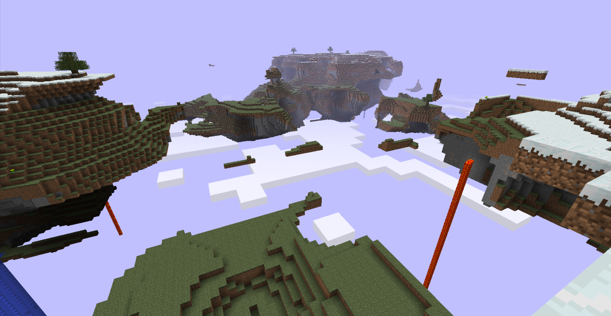

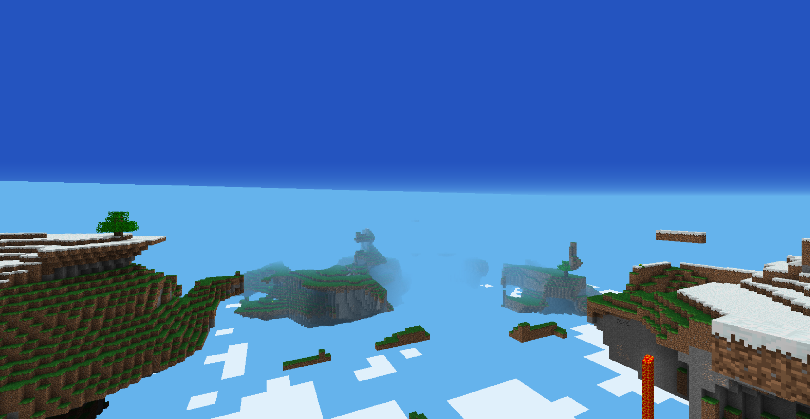

天域在 Java Beta 与原版 PE 视觉效果下的对比

### Alpha 世界

该世界类型基于 Minecraft Java Edition Alpha 1.1.2_01。世界中只会生成“Alpha”或“Winter”生物群系，以还原早期 Java 版的世界环境。草方块和树叶呈现与后续 Minecraft 版本不同的浅绿色。Alpha 世界支持洞穴生成。创建 Alpha 世界时，有 25% 的概率生成特殊的“Winter”冬季世界。

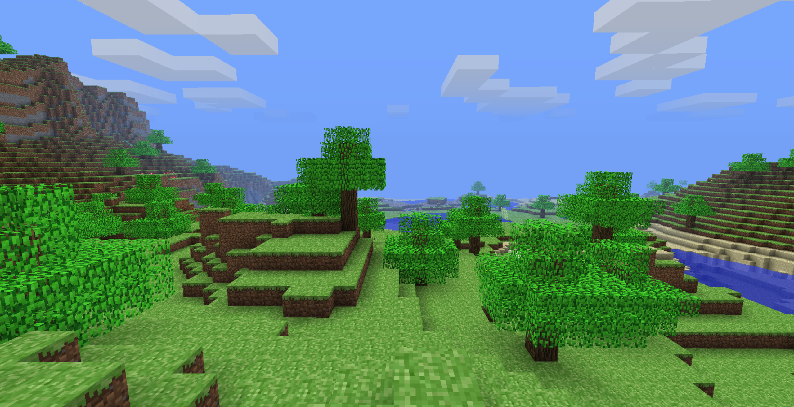

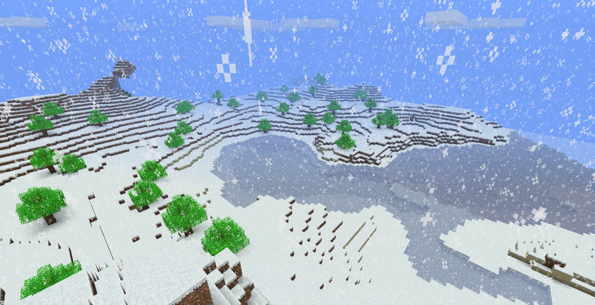

普通 Alpha 世界与特殊的“Winter”冬季世界

---

<h2 align="center">核心技术实现</h2>

- 使用基于 WGL 的原生桌面 OpenGL 渲染，取代早期的 PowerVR OpenGL ES 模拟方案。
- 支持 Windows x86、x64 和 ARM64 构建，并保留实验性的 ARM32 构建配置。
- 处理键盘、鼠标及触摸屏输入，并改进方块目标判定与交互。
- 为 Infinite、Sky 和 Alpha 世界实现多 Region 区块存储及扩展世界生成机制。
- 改进扩展世界的区块边界渲染、光照和出生点处理。
- 保留原版有限世界存档格式，以兼容经典 MCPE 世界。

若想了解技术细节和具体版本的变更请访问[更新日志](docs/Update_log.md)。

---

<h2 align="center">构建</h2>

打开目标架构对应的 Visual Studio 解决方案：

| 目标平台          | 解决方案                                           |
| ------------- | ---------------------------------------------- |
| Windows x86   | `handheld/project/x86/MinecraftWin32.sln`      |
| Windows x64   | `handheld/project/x64/MinecraftWin64.sln`      |
| Windows ARM64 | `handheld/project/arm64/MinecraftWinARM64.sln` |
| Windows ARM32 | `handheld/project/arm/MinecraftWinARM.sln`     |

在 Visual Studio 中选择所需的架构和配置。正常性能测试建议使用 Release 构建。Debug 构建主要用于调试，其运行速度可能明显更慢。

项目所需的原生库和运行时文件位于对应平台的库和游戏目录中，具体依赖目录结构与 Visual Studio 工程一同保留。编译游戏后，需要复制 `MCPE0.6.1Universal\handheld\data`，以及 `MCPE0.6.1Universal\handheld\lib\bin` 中对应架构文件夹内的 4 个依赖文件，之后即可运行游戏。

目前 ARM32 版本可以在我的 Windows on ARM 设备上启动并运行。由于该 WOA 环境下 ARM32 的 WGL 不支持 VBO，ARM32 游戏只能使用 OpenGL 1.1 进行渲染。即使使用最低画质设置，游戏也只能达到约 10 FPS。由于这些严重的性能和渲染问题，GitHub Releases 不会提供 ARM32 二进制文件，但源码和构建配置仍会保留。

由于支持 ARM32 的 UWP 版本已经实现，我之后大概率将不会继续开发这个尚未完成的 ARM32 Win32 版本。如果你的 Windows RT 设备运行 Windows 10 ARM32 桌面系统，可以尝试[我的 UWP 版本](https://github.com/CanghaiDragon/Minecraft-PE-0.6.1-UWP)。如果你的 RT 设备仍运行 Windows 8，可以尝试 [MCPE-0.6.1-WindowsRT](https://github.com/SamuraiArtem/MCPE-0.6.1-WindowsRT)（该 WindowsRT 仓库并非由我开发）。

---

<h2 align="center">键盘操作</h2>

| 按键 / 操作    | 功能             |
| ---------- | -------------- |
| W A S D    | 移动             |
| Space      | 跳跃             |
| Left Shift | 潜行             |
| 鼠标左键       | 挖掘 / 攻击        |
| 鼠标右键       | 放置方块 / 交互      |
| 1 - 9      | 选择快捷栏槽位        |
| 鼠标滚轮       | 滚动快捷栏          |
| E          | 打开物品栏          |
| Ctrl       | 切换奔跑状态（仅限创造模式） |
| F          | 切换旁观模式（仅限创造模式） |
| Q          | 丢弃物品           |
| R          | 打开合成界面（仅限生存模式） |
| F1         | 切换 HUD 显示/隐藏   |
| F3         | 切换调试界面         |
| F5         | 切换第三人称视角       |
| Escape     | 暂停 / 返回        |

---

<h2 align="center">已知限制</h2>

- Windows Win32 版本无法实现”Vibrate on Destroy“（破坏时振动）。
- 更换皮肤后可能需要重新启动游戏才能生效。
- ARM32 属于实验性版本，存在性能和渲染兼容性问题。
- 目前不支持 Infinite 和 Sky 世界的多人联机。

---

<h2 align="center">未来计划</h2>

- 中文本地化
- 为后续 MCPE 版本开发 Infinite/Sky 世界转换工具（正在进行中）
- 可能加入成就系统
- Infinite/Sky 世界多人联机

---

<h2 align="center">署名与声明</h2>

本仓库是基于泄露的 Minecraft Pocket Edition 0.6.1 源代码以及相关社区项目开发的独立延续项目。重新分发源代码或衍生项目时，请保留对上游项目的引用。

本项目与 Mojang Studios 或 Microsoft 无任何隶属关系，也未获得其认可或支持。
